# Lab DeFi 实验站 · 用户使用文档

> 本地 Besu Clique PoA 链上的 DeFi 教学实验站，共 12 个功能页。
> 所有交易在你的浏览器内用 ethers.js 本地签名，经服务器转发上链，私钥不出本机。
> 本文档基于对 12 种功能的完整实测编写（Besu 24.12 / chainId 1337 / 15 秒出块）。

***

## 一、快速开始

### 1.1 启动

```bash
# 1. 启动 Besu 链（RPC 端口 8545，Clique PoA，15 秒出一个块）
# 2. 启动实验站（在项目目录执行）
node server.js
# 3. 浏览器打开 http://localhost:3000
```

页面右上角显示「Besu 本地链 · Chain ID 1337 · 区块高度 …」即连接正常。

### 1.2 加载账户（钱包页）

三种方式任选：

| 方式     | 操作           | 说明                                               |
| ------ | ------------ | ------------------------------------------------ |
| 使用开发账户 | 点「使用开发账户」    | 服务器内置的 dev 账户（预置大量 ETH），课堂演示推荐                   |
| 创建新钱包  | 点「创建新钱包」     | 随机生成，私钥会显示在输入框——**务必自行保存**；余额为 0，需从 dev 账户转入 ETH |
| 导入私钥   | 输入 hex 私钥后回车 | 仅存本浏览器 localStorage                              |

打开页面时会自动恢复上次使用的钱包（无则自动加载 dev 账户）。

### 1.3 全局约定（务必先读）

- **每笔交易约 15 秒出块**，日志会显示「交易已广播 → ✅ 区块 N」，请勿重复点击按钮。

- 所有操作固定 **gasPrice 1 Gwei**，type 2 交易（maxPriorityFee=0）。

- 多数「部署」按钮是**多笔交易串行**（如质押池 = 部署 + approve + 注入，共 3 笔约 45 秒）。

- 合约地址登记在**本浏览器 localStorage**（见附录 A），换浏览器/清缓存后页面看不到旧合约，但链上一切仍在。

- 转账地址一律规范成小写 0x 地址（Besu 对非规范地址会报误导性错误）。

- **每笔交易广播前先本地模拟执行**（`eth_call` 预检）：余额不足、目标合约
  revert、未授权等错误在点击后立即以可读原因报出，不会广播必失败的交易。
  纯转账/授权/借款类交易若 2 分钟未上链（Besu 偶发丢交易）会**自动重发一次**；
  部署与下注类不可自动重发，超时时按日志提示核实后再操作（详见 FAQ 第 2、3 条）。

### 1.4 建议的体验顺序

```
钱包 → 代币（发币）→ NFT → 质押 → DEX → 借贷 → 预言机 → 乐高 → 治理 → 博彩 → 身份 → 桥
```

后 6 页有依赖关系：

- 借贷/乐高 需要「我的代币」里有代币；

- 乐高 还需要该代币已建 AMM 池 + 已部署预言机；

- 桥 的验证者复用预言机页的 3 个数据源私钥。

***

## 二、💼 钱包

| 功能       | 用法                             | 实测 |
| -------- | ------------------------------ | -- |
| 查看地址/余额  | 加载账户后自动显示；「刷新余额」手动更新           | ✅  |
| 转账 ETH   | 填接收地址 + 数量，点发送（gasLimit 21000） | ✅  |
| 查询任意地址余额 | 粘贴 0x 地址回车即可。除 ETH 外还会**自动扫描 ERC-20 代币余额**：来源 = 本浏览器「我的代币」登记簿 + 最近 4096 块链上 Transfer 日志发现；未登记代币会链上读取 name/symbol；链重置前的失效旧登记会标注「合约不存在」 | ✅  |
| 最近交易     | 本页列出最近 20 笔本地记录及状态（⏳/✅区块/❌）    | ✅  |

**提示**：dev 账户的 ETH 是课堂资源，创建新钱包后从这里转 ETH 过去。

<br />

dev 账户：0xCbd6949b0328EDF919b2883afAF0d413CfE68438

测试账号：0x07AD18573df76bB829fF9F6178A7dA740C35C1f2

**图解：代币余额自动扫描流程**

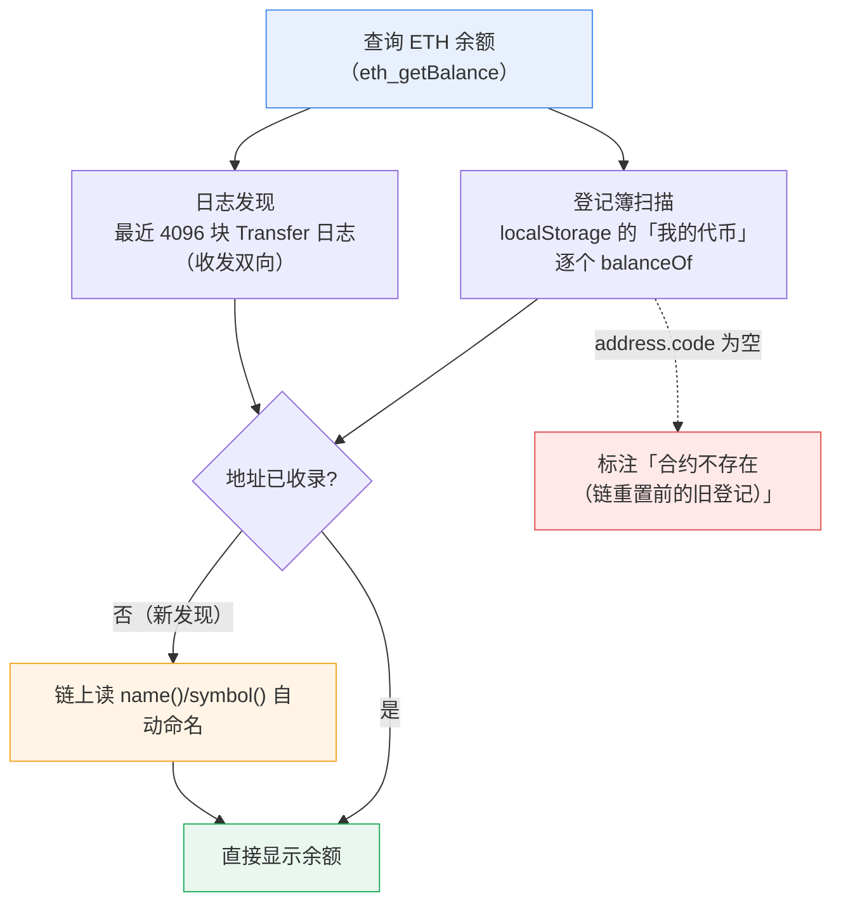

***

## 三、🪙 代币（发行 ERC-20 + 转账 + 收款查询）

### 3.1 发行代币

1. 填代币名称、符号、发行总量（默认 My Coin / MYC / 100 万，小数位固定 18）。
2. 点「🚀 发行代币」→ 等约 15 秒出块 → 日志显示合约地址。
3. **总量全部打入当前账户**；合约地址登记在「我的代币」列表。

### 3.2 转账

选代币 → 填接收地址 + 数量 → 转账。成功后自动在下方「收款查询」展示对方入账。

> 注意：数量按 18 位小数解析。数量过大或余额不足会得到 status=0 回执。

### 3.3 收款查询（按地址）

填代币合约地址（可从 datalist 选已登记代币）+ 接收地址，点「🔍 查询收到的代币」：
显示该地址当前余额 + 最近链上入账（Transfer 事件，倒序扫描最近 4096 块、最多 10 条）。

实测：发行 MYC → 转账 1000 → 收款方余额与入账事件均正确回显。✅

**图解：发行 → 转账 → 收款查询**

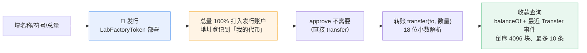

***

## 四、🎨 NFT（ERC-721）

### 4.1 铸造

1. 填藏品名称、tokenURI（支持 `data:application/json,{...}`，可点「填入示例 data:json」）。
2. 点「🪙 铸造」。**首次铸造会自动先部署一个 NFT 合约**（LabNFT，符号 LABN，2 笔交易）。
3. tokenId 由合约自增分配，铸造事件 Transfer(0x0 → 你)。

#### tokenURI 怎么填（data:application/json 内联元数据）

tokenURI 的本质：把一份 **ERC-721 元数据 JSON** 直接内联进 URI，而不是托管到 IPFS/服务器。
「填入示例 data:json」按钮填入的就是最简版：

```json
data:application/json,{"name":"Lab 藏品","description":"本链铸造的第一枚 NFT","image":""}
```

三个标准字段：`name`（钱包/市场显示的标题）、`description`（描述文字）、`image`（图片地址，可为空）。

带图片和属性的完整示例：

```json
data:application/json,{"name":"数字徽章","description":"Besu 本地链课堂纪念章","image":"data:image/svg+xml;base64,PHN2ZyB4bWxucz0iaHR0cDovL3d3dy53My5vcmcvMjAwMC9zdmciIHdpZHRoPSIxMDAiIGhlaWdodD0iMTAwIj48cmVjdCB3aWR0aD0iMTAwIiBoZWlnaHQ9IjEwMCIgZmlsbD0iIzRhOTBlZiIvPjx0ZXh0IHg9IjUwIiB5PSI1NSIgZm9udC1zaXplPSIyMCIgZmlsbD0id2hpdGUiIHRleHQtYW5jaG9yPSJtaWRkbGUiPkFCPC90ZXh0Pjwvc3ZnPg==","attributes":[{"trait_type":"稀有度","value":"SSR"},{"trait_type":"发行日","value":"2026-10-15"}]}
```

- `image` 也可填公网图片 URL（如 `https://.../badge.png`）；
- `attributes` 是 OpenSea 风格的可选属性数组，一般钱包会展示成标签。

**注意**：
1. JSON 必须是**单行**，双引号内不能有换行；
2. 中文可直接写；若钱包解析失败，把中文与 `{` `}` `"` 空格转成 URL 编码（如 `%E5%BE%BD%E7%AB%A0`）是最规范的写法；
3. 这份 JSON 会**永久存在链上**（每次 `tokenURI()` 都整段返回），mint 前先确认内容。
4. 验证：铸造后在 NFT 页点「🔍 链上确权」，会原样回显这段 URI。

### 4.2 确权 / 转让 / 收款查询

- 「🔍 链上确权」：逐枚调 ownerOf + tokenURI，回显真实持有人与元数据。✅

- 「转手（transferFrom）」：选藏品 + 接收地址即可。✅

- 「查询收到的 NFT」：按 Transfer 事件推算某地址当前实际持有的全部 tokenId。

**图解：首次铸双交易与生命周期**

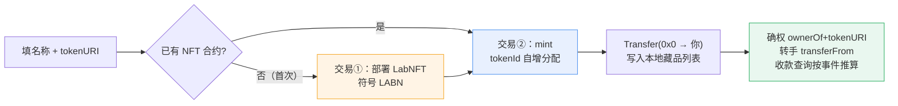

***

## 五、💎 质押（Synthetix 式奖励池）

### 5.1 应用场景：真实世界的质押都在做什么

「质押挖矿」（Staking / Liquidity Mining）是 DeFi 最基础的激励原语：**用户锁定资产 → 协议按时间发放奖励**。真实协议中的对应形态：

| 真实场景 | 质押物 | 奖励 | 代表协议 |
|---|---|---|---|
| 流动性挖矿 | LP 凭证 | 治理代币 | Curve / Convex |
| PoS 流动性质押 | ETH | stETH 收益（按秒重定基） | Lido |
| Launchpool / 活动挖矿 | BTC/ETH/稳定币 | 新发行代币 | 币安 Launchpool |
| 协议金库激励 | 协议自有代币 | 同种代币排放 | 各种 farming |

本站的 LabStaking 是这些形态的**公共内核**：任意 ERC-20 质押 + 按秒累计奖励。教学版做了简化——质押物与奖励是同一种代币（真实协议通常是两种：存 A 挖 B）。

### 5.2 工作原理：rewardPerToken 累计模型

合约 [LabStaking.sol](file:///Users/i/Desktop/DigitalLabs-web3/besu-local/dex-labs/contracts/LabStaking.sol) 是 Synthetix StakingRewards 的简化版。计时发奖有两条技术路线：

- **快照型**：每个块/每次事件记录"谁在何时质押了多少"，发放时回放所有快照。事件越多回放越贵。
- **累计型（本合约采用）**：维护一个全局累计量 `rewardPerToken`（每 1 wei 质押从池子诞生起累计分得的奖励，1e18 缩放），任何时刻的应得收益只需一次乘减除。O(1) 结算，这是 Synthetix/MasterChef 系的主流做法。

**核心状态变量**：

| 变量 | 含义 |
|---|---|
| `rewardRate` | 每秒全池奖励总量 = 注入量 / 3600 |
| `periodFinish` | 本期发完的时间戳，超过后停止累计 |
| `rewardPerTokenStored` | 全局累计量（惰性更新，读时补齐） |
| `userRewardPerTokenPaid[u]` | 用户 u 上次结算时全局累计量的快照 |
| `rewards[u]` | 已结算但未领取的奖励 |

**两个公式**（读 [源码](file:///Users/i/Desktop/DigitalLabs-web3/besu-local/dex-labs/contracts/LabStaking.sol#L39-L52)）：

```
rewardPerToken() = rewardPerTokenStored
                 + rewardRate × (now − lastUpdateTime) × 1e18 / totalStaked

earned(u) = rewards[u]
          + stakedOf[u] × (rewardPerToken() − userRewardPerTokenPaid[u]) / 1e18
```

直觉解释：`rewardRate × Δt` 是这 Δt 秒全池产出的奖励，除以 `totalStaked` 是"每份质押摊到多少"，乘回 `stakedOf[u]` 就是 u 的份额——**按质押量比例分配，谁质押多谁分得多，晚来的人只从进场时刻起算**。

**读即结算与先结算后业务**：`earned()` 是 view 函数，读取瞬间就算出最新待领数；所有写操作（stake/withdraw/getReward/depositReward）都先执行 `updateReward` 修饰器——把全局累计量和每个人的 `rewards` 结算到当前时刻，再执行业务。这是链上按秒计息的通用技巧：**账本永远停留在"最后一次被触碰的时刻"，读时补齐差值**。

**数字演算**（对应实测）：注入 10000 → `rewardRate = 10000/3600 ≈ 2.78/秒`（全池）。你质押 5000 且池内只有你 → 独享 2.78/秒，20 秒应得 ≈ 55.6 枚；若另一人也质押 5000 → 份额各半，每人 1.39/秒。整数除法向下取整，极端小额会有 1 wei 级精度损耗（合约已用 1e18 缩放 + 先乘后除把损耗压到最低）。

**教学简化点**：① 无锁仓期，随时 withdraw；② `depositReward` 再注入会覆盖 `rewardRate` 并重置 `periodFinish`，上期未发完的部分留在合约内不再分配（真实协议会滚动累加）；③ 奖励发完（`now > periodFinish`）后自动停止累计。

### 5.3 业务流程：从部署到清算的完整时序

**管理员侧（部署与注资）——前端打包为 3 笔串行交易：**

```
① 部署 LabStaking(token)          ── 合约拿到 admin = 部署者
② approve(池地址, 注入量)          ── 授权池子划走奖励金库
③ depositReward(注入量)           ── transferFrom 划款 → 设置 rewardRate = 量/3600
                                     periodFinish = now + 3600s，发放期开始
```

**用户侧（质押与清算）——随时可做，顺序自由：**

```
① approve(池地址, 质押量)          ── 授权池子划走质押物
② stake(质押量)                   ── transferFrom 划入 → totalStaked += 量
③ （等待，奖励按秒在 earned() 里持续上涨）
④ getReward()                     ── 只转 rewards 已结算部分，本金不动
⑤ withdraw(全部)                  ── 只退本金，待领奖励不动
   （④⑤ 互不影响，可任意交错；各自独立成笔交易）
```

**生命周期**：`部署 → 注资（发奖期 3600s 开始）→ 期内按秒累计 → 期末自动停发 →（可选）再次注资开启新一期`。

**与你自己的账本对账**：部署后用两个浏览器窗口（或创建新钱包转点代币）分别质押，观察「我的质押状态」卡里的「待领取奖励」——每 15 秒出一个新块，数字跳变一次；第二人进场瞬间，两人的增长速率都会减半，直观体会"按份额分配"。

**图解：奖励池资金流与生命周期**

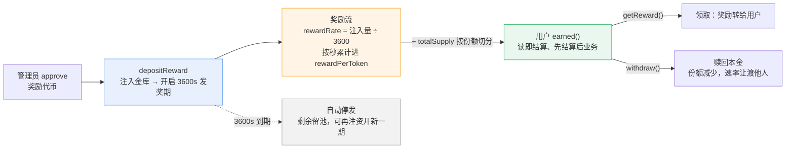

### 5.4 部署质押池

1. 选择要质押的代币（来自「我的代币」）。
2. 填「奖励金库注入量」（默认 10000，**3600 秒内按秒发完**）。
3. 点「🏗️ 部署质押池」= 部署合约 + approve + depositReward，共 3 笔约 45 秒（对应 5.3 管理员侧 ①②③）。

### 5.5 质押 / 领取 / 赎回

| 操作        | 说明                          |
| --------- | --------------------------- |
| 💎 质押     | 自动先发 approve 再 stake（共 2 笔，对应 5.3 用户侧 ①②） |
| 💰 领取收益   | getReward()，收益与本金同币种        |
| ↩️ 赎回全部本金 | withdraw 全部质押量              |

「我的质押状态」卡只读展示：质押中数量、待领取奖励、池内总质押、奖励速率/本期剩余秒数。

实测：注入 10000 后速率 = 10000/3600 ≈ 2.78/秒；质押 5000 枚，20 秒应计 ≈ 55.6 枚，实际领取数与数学完全吻合。✅

***

## 六、🔁 DEX（恒定乘积 AMM）

### 6.1 应用场景：链上兑换为什么用"池子"

去中心化交易所（DEX）解决的核心问题：**没有撮合对手盘时如何定价成交**。订单簿模式（挂单吃单）在链上又贵又慢，AMM 用一个链上资金池代替对手盘——任何人随时按公式报价成交。真实世界的对应形态：

| 真实场景 | 不变式 | 代表 |
|---|---|---|
| 通用币币兑换 | x·y = k（恒定乘积） | Uniswap V2、PancakeSwap |
| 稳定币/同质资产互换 | 混合曲线（集中流动性） | Curve |
| 集中流动性做市 | 区间内自定义曲线 | Uniswap V3 |
| 交易聚合路由 | 拆单走多个池子找最优价 | 1inch、Matcha |

本站的 [LabAMM](file:///Users/i/Desktop/DigitalLabs-web3/besu-local/dex-labs/contracts/LabAMM.sol) 是 Uniswap V2 的最小化版本：**单池、原生 ETH ⇄ 一种 ERC-20**，教学简化点——LP 份额用 mapping 内部记账（真实 Uniswap 发行 ERC-20 的 LP 代币，可再质押/转让）。

### 6.2 工作原理：x·y = k 与 0.3% 手续费

**恒定乘积不变式**：池内 ETH 储备 x、代币储备 y，交易前后乘积只增不减：

```
交易前  x·y = k
用 Δx 买代币 →  (x + Δx)·(y − Δy) = k  →  Δy = y·Δx / (x + Δx)
```

直觉：买 ETH 侧的代币，池内代币变少、ETH 变多，价格自动沿曲线上滑——**买得越多越贵**，这就是价格冲击。手续费的处理：把 0.3% 从输入里扣掉再进公式，**全额（含手续费）计入储备**，因此每次交易后 k 都变大——手续费沉淀在池子里，由全体 LP 按份额分享（这就是"做市赚手续费"）。

**合约报价公式**（[getAmountOut](file:///Users/i/Desktop/DigitalLabs-web3/besu-local/dex-labs/contracts/LabAMM.sol#L36-L44)，先乘后除保精度）：

```
Δy = y × (Δx × 997) / (x × 1000 + Δx × 997)
```

**精确演算**（1 ETH + 2000 代币的池，买入 0.05 ETH）：

```
Δy = 2000 × 49.85 / (1000 + 49.85) = 94.98 枚
```

注意对比：按初始价线性估算 0.05×2000 = 100 枚，只扣手续费约 99.7 枚，**实际只有 94.98 枚**——差值就是价格冲击。交易相对池子越小，结果越接近线性估算；相对池子越大，冲击越狠。所以同一个池子，第一笔 0.05 ETH 和第二笔 0.05 ETH 成交价不同。

**报价即执行**：前端「获取报价」直接 `eth_call` 合约的 `getAmountOut`（只读预演，不花 gas），和真正 swap 用的是同一个函数——报价不会骗人，但出块要约 15 秒，**成交以出块那一刻的池子状态为准**。

**LP 份额记账**（[addLiquidity / removeLiquidity](file:///Users/i/Desktop/DigitalLabs-web3/besu-local/dex-labs/contracts/LabAMM.sol#L47-L85)）：

| 时机 | 规则 |
|---|---|
| 首注建池 | 价格由你给的 ETH:代币比例决定；LP = 首注 ETH 量 |
| 续注 | 代币按池内比例自动配对（needToken = y×ΔETH/x），你填的代币数量只是**滑点上限**，超出即回滚 |
| 撤出 | 按 lp/totalLP 份额等比例退回 ETH + 代币（含累计手续费收益） |

### 6.3 业务流程：完整时序

**LP 侧（做市）：**

```
① 部署 LabAMM(token)               ── 构造时绑定池子另一侧代币
② approve(池地址, 代币量)           ── 授权池子划走代币
③ addLiquidity{ETH}(maxToken)      ── ETH 随交易带入，代币 transferFrom 划入
                                      首注定价 / 续注自动配对，铸造 LP 份额
④ （池子持续被交易，手续费沉淀进池）
⑤ removeLiquidity(lp)              ── 等比例取回 ETH + 代币
```

**交易员侧（兑换）：**

```
ETH → 代币：  swapETHForToken()      ── ETH 随 msg.value 带入，1 笔交易
代币 → ETH：  approve(池, 量) → swapTokenForETH(量) ── 2 笔交易
```

**对账实验**：建池 1 ETH + 2000 代币后，连续报价 0.05 / 0.05 / 0.05 ETH 三次——你会看到报价逐笔递减（池子被买偏），直观感受价格冲击；再用「撤出全部流动性」对账，取回的两边资产与「池状态」卡显示的份额一致。

**图解：建池、兑换与手续费回路**

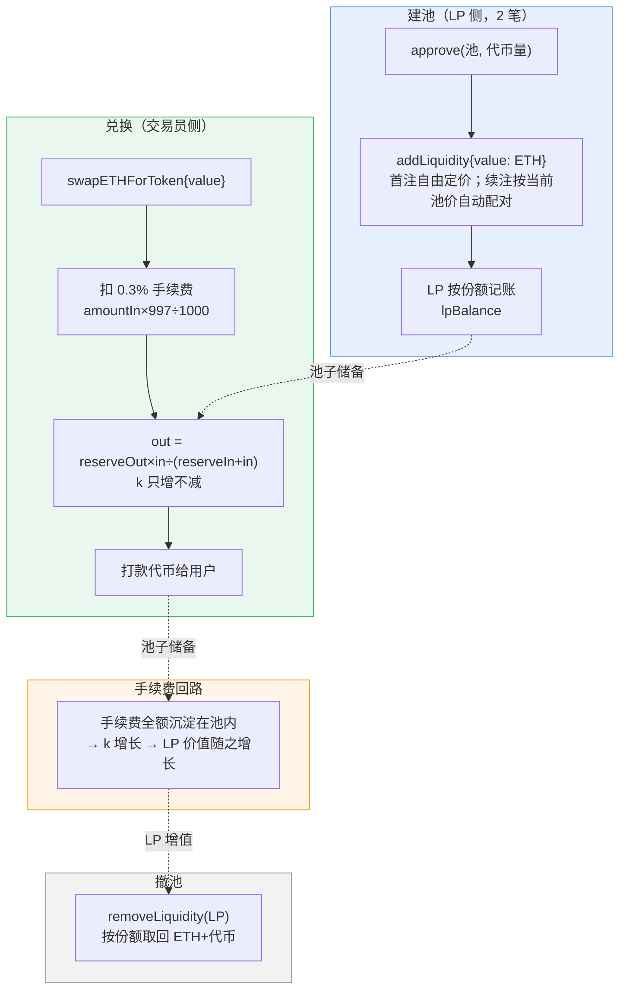

### 6.4 建池 / 注入流动性

- 选代币，填 ETH 数量 + 代币数量（默认 1 ETH + 2000 代币），点「💧 注入流动性」。

- **首注自动建池**，价格由你给的比例决定（1 ETH = 2000 代币）；续注按池内比例自动配对代币，代币数量此时是滑点上限（对应 6.3 LP 侧 ①②③）。

- 注入后获得 LP 份额（内部记账，无 ERC-20 LP 代币）。

### 6.5 兑换

1. 选方向（ETH→代币 / 代币→ETH），填数量。
2. 「💱 获取报价」：只读预演，**已扣 0.3% 手续费**（见 6.2 演算）。
3. 「🔄 执行兑换」：ETH→代币直接带 value 发送；代币→ETH 先 approve 再 swap（2 笔）。

### 6.6 撤出流动性

「↩️ 撤出我的全部流动性」：按 LP 份额比例退回 ETH + 代币。

实测：1 ETH + 2000 代币建池 → 双向兑换、报价与合约 `getAmountOut` 一致、撤 LP 金额与份额数学一致，全部成功。✅

> 兑换无最小输出滑点保护（教学简化）：出块的 15 秒窗口里若池子被别人先交易，你的成交价会偏离报价——真实 Uniswap 的 `amountOutMin` 参数就是防这个的。

***

## 七、🏦 借贷（ETH 抵押借代币）

### 7.1 应用场景：没有信用体系的链上信贷

DeFi 借贷解决的核心问题：**在互相不认识、没有征信的世界里，如何安全地放贷**。答案是超额抵押——借款人锁入价值更高的资产（ETH），才有资格借出其他资产。借款人不出售 ETH（保留上涨敞口），同时拿到现金（代币）用于其他用途，这是真实世界最主流的用法。真实协议对照：

| 真实协议 | 形态 | 代表机制 |
|---|---|---|
| Compound V2 | 资金池借贷 | cToken 计息凭证，利率随资金利用率浮动 |
| Aave V3 | 资金池借贷 | aToken、健康度（Health Factor）、清算奖金 5%~15% |
| MakerDAO | CDP 抵押铸币 | 锁 ETH 铸 DAI，ETH-A 清算线约 170%（即抵押率 ≈59%） |

本站 [LabLending](file:///Users/i/Desktop/DigitalLabs-web3/besu-local/dex-labs/contracts/LabLending.sol) 是 Compound/Aave 的最小化版本：单一 ETH→代币借贷对。教学简化点——① 利率由管理员固定（真实协议随资金利用率浮动）；② 利息留在代币池（真实协议分给出资人）；③ 价格来自「模拟预言机」（管理员 `setPrice`，真实协议由 Chainlink 喂价）；④ 演示利率**每秒 1%**（真实协议年化个位数），让利息和清算肉眼可见；⑤ 清算是全仓清算（真实协议通常部分清算）。

### 7.2 工作原理：抵押率、单利债务与健康度

三个核心公式（与合约逐行对应）：

```
最大可借 maxBorrow = 抵押ETH × 66% × 价格 − 现有债务        （CF = 66%）
应计债务 debtOf    = 本金 × (1 + 每秒利率 × 经过秒数)        （单利，先乘后除保精度）
健康度 healthFactor = 购买力 / 债务    （购买力 = 抵押ETH × 66% × 价格；< 1.0 可被清算）
```

**精确演算**（1 ETH 抵押，价格 2000，借 1000）：

```
最大可借 = 1 × 0.66 × 2000 = 1320 枚
借 1000 后健康度 = 1320 / 1000 = 1.32
演示利率 1%/秒：债务第 32 秒涨到 1000×1.32 = 1320 → 健康度恰好跌破 1.0
```

两个推论：① **借满上限 = 立即可被清算**——第一秒利息就会把健康度压到 1.0 以下，安全做法是借款额留出缓冲（这正是页面默认借 1000 而非 1320 的原因）；② 演示利率把时间压缩了约 600 万倍——「借 1000 后 32 秒债务 +32%」在真实协议年化约 5% 下需要 5~6 年（或价格下跌约 24%），触发清算的是同一套数学。

**清算经济学**（[liquidate](file:///Users/i/Desktop/DigitalLabs-web3/besu-local/dex-labs/contracts/LabLending.sol#L136-L149)）：任何人替欠款人**还清全部债务**（代币），即可拿走其**全部抵押 ETH + 最高 8% 奖金**（奖金封顶到合约 ETH 余额）。演算：债务 1320 枚（= 0.66 ETH 等值）时清算，付出 0.66 ETH 等值代币，拿走 1.08 ETH——清算人赚差价，欠款人为风险买单。真实协议用部分清算 + 保险基金把冲击做小，但激励结构相同。

**资金流**：管理员 `fund` 把代币注入可借池 → 借款把池子转给借款人 → 还款（本金+利息）回池 → `withdraw` 取回抵押 ETH（校验剩余购买力 ≥ 债务，防抽走抵押跑路）。抵押 ETH 全程锁在合约里（`receive()` 接收的普通转账只进余额、不算抵押，只是清算法金缓冲）。

### 7.3 业务流程：三个角色的时序

**管理员（部署+供资）：**

```
① deploy(token, 价格, 利率)   ── 绑定借贷对与初始参数
② approve(市场, 代币量)        ── 授权 fund 划款
③ fund(注入量)                ── 代币进入可借池（此后 repay 也回这个池）
④ （可选）setPrice(新价格)     ── 模拟预言机调价，演示价格风险
```

**借款人：**

```
① deposit{ETH}      ── ETH 锁入合约，记入 ethCollateral
② borrow(数量)      ── 合约校验 maxBorrow 与池子余量，代币转出，开始计息
③ （等待）          ── 债务每秒上涨，「我的账户」卡实时可见
④ repay(数量)       ── 先 approve 再还款；必须 ≥ 应计利息；还清后本金清零
⑤ withdraw(数量)    ── 剩余购买力 ≥ 债务时才能取回
```

**清算人（另一账户）：**

```
① 监控目标账户 healthFactor < 1.0
② approve(市场, 债务额) → liquidate(目标地址)   ── 代币还债，换走全部抵押+8%
```

**对账实验**：A 存 1 ETH 借 1000 → 等 32 秒让健康度跌破 1.0 → B（另一账户，需持 ≥1320 代币）执行清算 → A 的抵押清零、B 多拿 0.08 ETH 奖金——健康度、清算线、奖金三个概念一次看全。

**图解：三角色资金流与健康度生命周期**

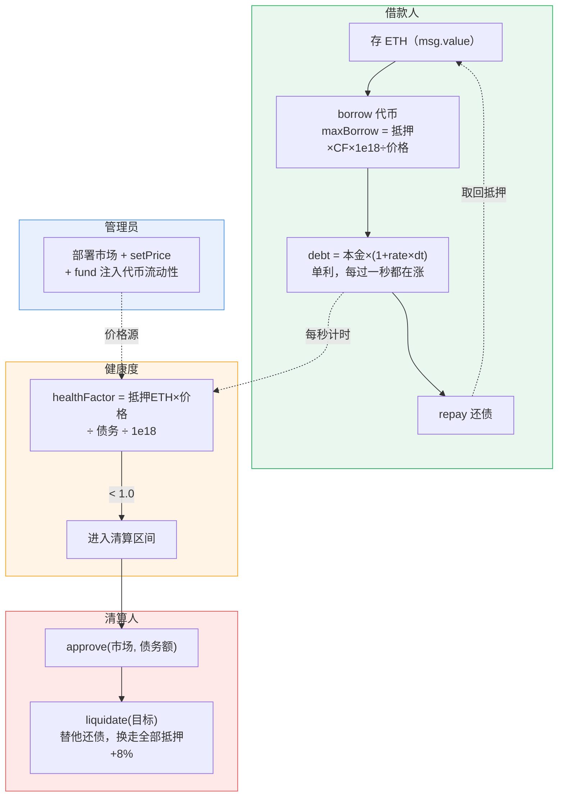

### 7.4 部署市场

填初始价格（1 ETH = ? 代币，默认 2000）与注入可借资金（默认 10000），点「🏗️ 部署市场」\= 部署 + approve + fund，共 3 笔（对应 7.3 管理员侧 ①②③）。

**参数**：抵押率 66%、清算线健康度 1.0、演示利率**每秒 1%**（见 7.2 演算）。

### 7.5 操作流程

1. 📥 存入 ETH 作抵押（默认 1 ETH）。
2. 💸 借出代币：1 ETH × 66% × 2000 = **最多可借 1320**；建议借 ≤1000 给健康度留缓冲（借满 1320 会立即进入清算区间，见 7.2）。
3. 💰 还清全部：自动读当前债务并 2 倍超额授权+还款（出块期间利息还在涨，合约只收实际债务）。
4. ↩️ 取回全部抵押 ETH：有未还债务时会被拒。

「我的账户」卡只读：抵押 ETH、本金、应计债务（每秒上涨）、健康度、最大可借、池内可借/当前价格。

实测闭环：存 1 ETH → 借 1000 → 债务按秒上涨 → 还清 → 取回抵押，全部成功。✅

> 注意：页面默认「借出 1000」，若你把初始价格改低（如 1000），需先存够抵押物再借，否则 borrow 回执 status=0（超额抵押校验在合约内，属正常保护）。

***

## 八、📡 预言机（多数据源中位数聚合）

### 8.1 应用场景：智能合约为什么必须"喂价"

EVM 是确定性沙箱：同一笔交易在所有节点必须算出完全相同的结果，所以**合约不能上网查行情**——价格只能由链下"推"进来，这套机制就是预言机（Oracle）。没有预言机就没有 DeFi：借贷清算需要知道 ETH 值多少、稳定币需要锚定价、衍生品需要行情。但单一数据源不可信（挂了/作恶了怎么办？），业界的共识答案是**多数据源 + 聚合**。真实形态对照：

| 真实方案 | 机制 | 特点 |
|---|---|---|
| Chainlink | 独立节点网络各自取价 → 链上聚合 | 最主流；节点押 LINK、作恶罚没 |
| Pyth | 第一方（交易所/做市商）高频推送 | 延迟毫秒级，Solana 系常用 |
| Uniswap TWAP | 用链上池价做时间加权平均 | 无需外部依赖，但可被区块内操纵、且滞后 |
| MakerDAO 喂价 | 专门喂价合约 + 中位数 | OSM 延迟一小时生效，防闪电贷套利 |

聚合方式上，**中位数比平均数抗操纵**：本站 [LabOracle](file:///Users/i/Desktop/DigitalLabs-web3/besu-local/dex-labs/contracts/LabOracle.sol) 采用 Chainlink 的思路——白名单数据源各自独立报价，合约排序取中位数，异常值被自然过滤。教学简化点：① reporter 是手动按键报价（真实节点按心跳/价格偏差自动触发）；② 无质押与罚没（真实节点押资产作恶被罚）；③ minReports 部署后固定（真实协议可调）。

### 8.2 工作原理：白名单 → 报价 → 中位数 → 轮次

四步流水线（与合约逐行对应）：

```
① 白名单   admin addReporters(地址数组)     ── 只有注册过的账户能报价
② 报价     report(price)                    ── 各数据源独立报价（1e18 缩放），存 priceOf
③ 聚合     _aggregate()                     ── 有效报价排序取中位数（偶数个取中间两数平均）
④ 轮次     roundId += 1，写入 rounds 历史    ── 报价数达 minReports 门槛才形成新轮次
```

**为什么是中位数**——精确演算（3 个数据源报 2000 / 2002 / 99999）：

```
平均数 = (2000 + 2002 + 99999) / 3 = 34667   ← 被一笔恶意报价拉爆
中位数 = 排序 [2000, 2002, 99999] 的中间值 = 2002   ← 操纵失效
```

中位数的操纵成本：攻击者必须控制**超过半数**的报价者才能拉动结果（3 源需 ≥2 个、4 源需 ≥3 个串谋）；而平均数一笔 99999 就得手。偶数源的例子：4 源报 2000/2002/2005/99999 → 中位 = (2002+2005)/2 = 2003.5。

**三个配套机制**：

| 机制 | 行为 | 对应真实协议 |
|---|---|---|
| minReports 门槛 | 有效报价数不足时聚合搁置（roundId 不涨）——防少数人形成轮次 | Chainlink 的 minSubmissions |
| refresh() | 任何人可手动触发再聚合（数据源变动/补报后） | 心跳到期 / 偏差超阈值时节点触发 |
| pendingMedian() | 只读预演"若现在聚合"的中位数与报价数，不写状态 | 无直接对应（教学便利） |

**staleness（数据新鲜度）**：消费方读价时应检查 `latestTimestamp` 距今是否过久——聚合没有发生，`latestAnswer` 会一直停在旧轮次。真实 Aave 对 Chainlink 价格同样做过期校验。

### 8.3 业务流程：三个角色的时序

**管理员（部署+注册数据源）：**

```
① deploy(初始价格, minReports)   ── 第 0 轮 = 创世价，roundId 从 0 起
② addReporters([r1, r2, r3])     ── 一笔交易批量注册白名单
③ （可选）removeReporter(r)      ── O(1) 换血，同时清空其历史报价
```

**数据源（每个 reporter 用独立私钥）：**

```
report(price)   ── 写入自己的报价 → 合约自动尝试聚合（门槛够则出新区）
```

**消费方（以借贷市场为例）：**

```
读 oracle.latestAnswer + latestTimestamp（校验新鲜度）→ lending.setPrice(answer)
```

**对账实验**：3 源报 2000/2002/99999 → 全部上链后 latestAnswer = 2002（中位数），roundId 正常递增——白名单、门槛、中位数抗操纵三个机制一次看全（详细场景表见 8.5）。

**图解：报价-聚合-消费流水线**

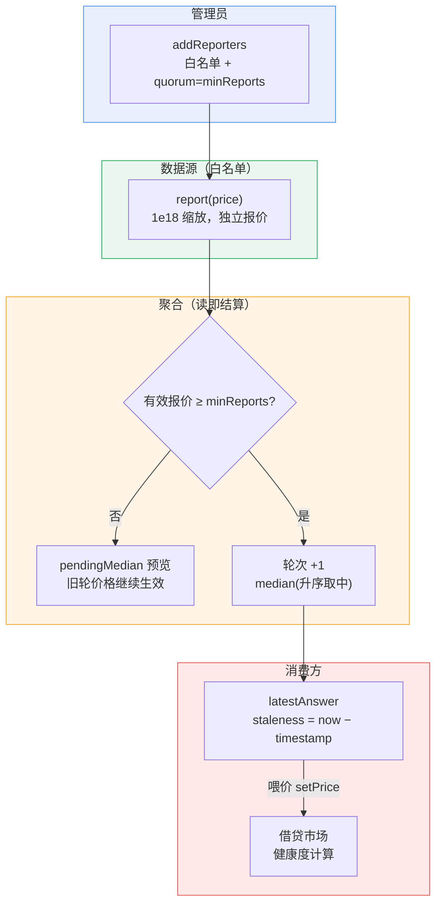

### 8.4 部署与数据源

1. 填初始价格（2000）与聚合最少报价数（默认 2），点「🏗️ 部署预言机」。
2. 点「🔧 一键准备 3 个测试数据源」：自动创建 3 个链上账户 → dev 逐个转 0.02 ETH gas（严格串行）→ 一笔 addReporters 批量注册白名单。私钥仅存本浏览器（对应 8.3 管理员侧 ①②）。

### 8.5 报价与聚合（三种一键场景）

| 场景                     | 报价         | 预期聚合              |
| ---------------------- | ---------- | ----------------- |
| 正常 2000/2005/1995      | 3 笔串行上链    | 中位数 2000          |
| 🚨 异常值 2000/2002/99999 | 恶意报价 99999 | **中位数 2002，操纵失效** |
| 行情上涨 2100/2105/2095    | 3 笔串行      | 2100              |

- 每来一笔报价合约自动尝试聚合；报价数不足门槛时轮次不动（roundId 不涨，见 8.2 机制表）。

- 「🔄 手动触发聚合（refresh）」：随时强制聚合。

- 「若现在聚合」显示当前 pendingMedian 与有效报价数。

实测攻击场景：三笔 2000/2002/99999 全部上链后，latestAnswer = 2002（中位数），round 正常递增。✅

### 8.6 喂价给借贷市场

选借贷市场（按借出资产）→「⬇️ 把预言机最新价同步到借贷市场」。
前提：当前账户同时是该借贷市场的 admin。这就是 Aave/Compound 消费 Chainlink 价格的最小模型（消费方先验新鲜度再落价，见 8.2 staleness）。

***

## 九、🧱 DeFi 乐高（LP 抵押借贷金库）

**三合一**：AMM 池 + 预言机价格 + LP 抵押借贷。前置：该代币已在 DEX 页建池、预言机页已部署。

### 9.1 应用场景：Money Legos——把别人的模块拼成新产品

DeFi 的绰号叫 **Money Legos（金钱乐高）**：每个协议都是一个标准积木（代币、DEX、预言机、借贷），新协议把别人的积木插进来就能长出新能力。本节的 [LabLego](file:///Users/i/Desktop/DigitalLabs-web3/besu-local/dex-labs/contracts/LabLego.sol) 就是一次最小化拼装：**LP 不再只是躺在池子里赚手续费，而是可以抵押出去借代币**——同一份资本同时做市 + 融资，这就是"资本效率"的提升。真实世界对照：

| 真实案例 | 拼法 |
|---|---|
| Aave v2 AMM 市场 | 接受 Uniswap/Sushiswap 的 LP 代币作抵押品 |
| Yearn / Convex | 金库托管 LP 自动复投收益，再发行金库凭证 |
| 各种 wrapped LP（如 stETH 的包装凭证） | 给不可转让/不可拆分的仓位包一层 ERC-20 使其可流通 |

**为什么需要一个"金库适配层"**：Uniswap V2 的 LP 是 ERC-20，用户可以 approve 直接转给借贷合约；而本站 LabAMM 的 LP 是内部 mapping 记账（见 6.2），**不可转让**——没法"过户"给金库。解法：金库替用户去 AMM 建仓，LP 记在金库名下，金库内 `lpCollateral[user]` 分户记账。这个 Adapter 模式没有改动 AMM 一行代码，正是乐高式开发的精髓：**用包装适配代替改造原协议**。教学简化点：① 单池单代币；② 利率固定每秒 1%；③ 清算所得 LP 直接给清算人（真实协议通常折价拍卖）。

### 9.2 工作原理：LP 三段估值与"折扣购买"清算

**LP 估值**（[lpValue](file:///Users/i/Desktop/DigitalLabs-web3/besu-local/dex-labs/contracts/LabLego.sol#L83-L97)）：你的 LP 份额对应池内一定比例的两边资产，折成代币计价：

```
ethPart    = reserveETH  × 你的LP / totalLP      ── LP 里的 ETH
tokPart    = reserveToken × 你的LP / totalLP     ── LP 里的代币
valueToken = ethPart × 预言机价 + tokPart        ── 两边折算成代币的总价值
```

**精确演算**（池 1 ETH : 2000 代币，质押 0.1 ETH 建仓，预言机价 2000）：

```
ethPart = 0.1 ETH × 2000 = 200 代币等值
tokPart = 200 代币
valueToken = 200 + 200 = 400 代币
购买力 = 400 × 50% = 200 代币
```

**抵押率为什么降到 50%**（纯 ETH 是 66%）：LP 是"半个 ETH + 半个代币"的组合，代币那半边本身就波动大；且交易会让持仓比例漂移（无常损失，见 6.2）。资产质量更差，真实协议给的 LTV 也更低（Aave 对 LP 类抵押通常只给 25% 左右）。

**"折扣购买"清算**（[liquidate](file:///Users/i/Desktop/DigitalLabs-web3/besu-local/dex-labs/contracts/LabLego.sol#L222-L238)）：健康度 < 1.0 时，清算人**还清全部债务**，按 LP 单价 `lpPrice()` 的 **1.08 倍**折算拿走对应 LP 份额，**剩余 LP 留给欠款人**：

```
seizeLP = 债务 × 1.08 / LP单价        （wantLP ≤ 抵押LP 才执行，否则视为穿仓）
```

对比第 7 章的全仓清算：那里奖金要从合约 ETH 余额里出（封顶到余额）；这里 **LP 本身就是资产组合**，8% 奖金来自"折扣购买"的价差，协议不用另备资金——这是 LP 作抵押品的一个真实优势。债务与健康度的数学与借贷市场完全相同（单利、每秒复算、<1.0 可清算）。

**一个新风险维度**：纯 ETH 抵押的估值只随预言机价变动；LP 抵押的估值是**内生**的——池子被人交易（储备变动）、预言机调价，都会立刻改变你的抵押品价值，健康度有两个抖动源。这也是真实协议对 LP 抵押更保守的另一个原因。

### 9.3 业务流程：三个角色的时序

**管理员（部署+供资）：**

```
① deploy(token, amm, oracle, 利率)   ── 绑定三个积木的地址
② approve(金库, 代币量)
③ fund(注入量)                        ── 可借代币池（repay 回这个池）
```

**用户（LP 借款人）：**

```
① approve(金库, maxToken)     ── 授权金库代你划代币（滑点上限）
② stakeLiquidity{ETH}         ── 金库向 AMM 建仓，LP 记到你名下
③ borrow(数量)                ── ≤ LP估值×50%，代币到手
④ （等待/还款）                ── 债务每秒上涨
⑤ repay(approve 后还款) → unstake(lp)   ── 赎回后 ETH+代币回钱包
```

**清算人（另一账户）：**

```
① 监控目标 healthFactor < 1.0
② approve(金库, 债务额) → liquidate(目标)   ── 还债换 LP（1.08 倍折算）
③ unstake(拿到的 LP)                        ── 变现成 ETH+代币
```

**数字演算（与 9.6 一键演练完全对应）**：借款人得 0.15 ETH + 220 代币 → 质押 0.1 ETH（配对 200 代币，1:2000 池）→ LP 估值 400 → 购买力 200 → **借 60% = 120 枚 → 健康度 1.67**；每秒 1% 利息下债务涨到 200 枚（×1.67）需要 **约 67 秒** → 健康度跌破 1.0 → 可清算。

**图解：LP 抵押借贷金库（组合层架构）**

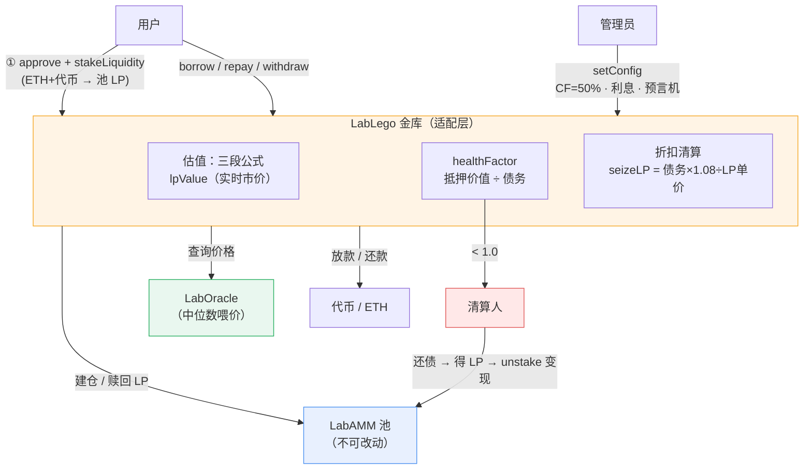

### 9.4 部署金库

填注入可借代币（fund，默认 10000）→「🏗️ 部署金库」= 部署 + approve + fund（3 笔，对应 9.3 管理员侧）。

**参数**：LP 抵押率 50%（低于纯 ETH 的 66%，因 LP 承担无常损失，见 9.2）、清算折扣 8%、利率每秒 1%。

**注入兜底**：fund 回执后页面会立即读 `tokenPool()` 验证资金确实到账（此前曾出现
fund 交易被节点丢弃、金库以 0 可借池"就绪"，直到借款才报 pool empty）；未生效会
直接提示重新点「一键准备」补注入。借款预检也会把 `pool empty` / `under collateral`
revert 翻译成具体指引。

### 9.5 日常操作

| 操作         | 说明                                                                 |
| ---------- | ------------------------------------------------------------------ |
| 🔒 质押流动性   | approve maxToken → 金库代你向 AMM 建仓并把 LP 锁进金库（ETH + ≤maxToken 代币，滑点保护；首注定价、续注按池比例配对，同 6.2 LP 三规则） |
| 💸 借出      | LP 估值 × 50% 之内借代币                                                  |
| 💰 还清全部    | 读债务 + 2 倍超额授权还款                                                    |
| ↩️ 撤出全部 LP | 金库向 AMM 赎回，ETH+代币回到钱包；撤完剩余购买力 < 债务会被拒（与 7.2 withdraw 同一保护）     |

### 9.6 清算演练（一键）

1. 点「🔧 一键准备借款人」：自动开户（转 0.15 ETH + 220 代币）→ approve → 质押 0.1 ETH 流动性 → 借到最大购买力的 60%（数字见 9.3 演算）。
2. **等约 70 秒**，每秒 1% 利息把健康度从 1.67 磨到 1.0 以下。
3. 点「⚡ 清算该地址」：当前账户代还债务，拿 8% 折扣的 LP（模型见 9.2）。
4. 清算所得 LP 点上方「撤出全部 LP」变现。

实测：fund→质押→借款（maxBorrow×60%）→还款→撤 LP 全链路通过；健康度、LP 估值（ETH 部分+代币部分）显示与合约数学一致。✅

***

## 十、🗳️ 治理（ERC-20Votes + Governor + Timelock）

### 10.1 应用场景：把 admin 权限交给社区

前面所有模块都有同一个隐患：**合约里有个 admin 可以改参数**（借贷改价格、赌场收放资金、预言机增删数据源……）。持有 admin 私钥的人是单点故障——丢了丢钱，坏了作恶。去中心化治理的答案：**把 admin 移交给一套"持币者投票 → 时间锁 → 执行"的程序化流程**，没有任何人能绕过流程改合约。这就是 Compound、Uniswap、Aave 至今运行的方式。真实治理系统对照：

| 真实系统 | 治理代币 | 关键参数（量级） |
| --- | --- | --- |
| Compound Governor Bravo | COMP | 提案门槛 2.5 万票、投票 3 天、Timelock 2 天、quorum 10 万票 |
| Uniswap Governance | UNI | 提案门槛 250 万票、投票 7 天、Timelock 2 天 |
| OpenZeppelin Governor | 任意 ERC-20Votes | 与 Bravo 同构，支持 EIP-712 离线签名投票 |

本站 [LabGovernance.sol](file:///Users/i/Desktop/DigitalLabs-web3/besu-local/dex-labs/contracts/LabGovernance.sol) 是 Compound Bravo 的精简版，四个合约各对应真实栈的一层：LabVoteToken（ERC-20Votes 投票权）→ LabGovernor（提案/计票）→ LabTimelock（延迟队列）→ LabBox（被治理的资产）。教学简化点：① 提案只含单个 action（真实是批量调用数组）；② 无 EIP-712 签名投票；③ Timelock 换手用 setAdmin 直接改（真实的换手本身也要排队自举）；④ 投票期/延迟用秒而不是区块数，配合 15 秒出块的课堂节奏。

### 10.2 工作原理：四层权力架构与三个防作弊机制

**权力架构**——每一层只能被上一层"合法驱动"：

```
LabVoteToken ──票数──> LabGovernor ──提案通过后排队──> LabTimelock ──延迟到期才 call──> LabBox.setValue
（投票权来源）        （社区意志）                    （冷静期）                     （受控资产）
```

部署后 Box 的 owner 是 Timelock，**直接调 setValue 一定被拒**——唯一写入口只剩「提案→投票→排队→延迟→执行」。

**机制一：委托与检查点（持币 ≠ 有票）。** 投票权独立于余额记账：持币人必须 `delegate`（常委托给自己）票才生效。每次余额/委托变动写一个检查点（fromBlock → votes），查历史票数用二分查找最近检查点（[getPriorVotes](file:///Users/i/Desktop/DigitalLabs-web3/besu-local/dex-labs/contracts/LabGovernance.sol#L147-L164)）。转账时票跟着"票主"走：未委托者票在自己头上，已委托者票在委托目标头上——一条规则覆盖全部四种组合，票数全程守恒。

**机制二：提案快照（防闪电贷买票）。** 提案锁定 `snapshotBlock = 提案区块 − 1`，计票用 `getPriorVotes(投票人, 快照块)`——**提案之后才买入/委托的代币一律不计票**。没有快照的话，攻击者可以闪电贷借入巨量治理代币、投完票、同一笔交易里还掉，成本几乎为零；快照让"未来的钱"买不了"过去的票"。

**机制三：Timelock 延迟（社会共识缓冲期）。** 提案通过后必须排队，**30 秒（真实协议 1~2 天）后才可执行**。这段延迟的意义：给持币者留出"不同意就卖出/退出"的反应时间——恶意提案在执行前会被市场看见。宽限期 1 天，到期不执行作废（状态 Expired）。

**提案状态机**（OZ/Bravo 同款 8 态）：

| 状态 | 含义 / 进入条件 |
| --- | --- |
| 1 Active | 窗口内（教学版省略 Pending） |
| 2 Canceled / 7 Executed | 提案人取消 / 延迟后执行成功 |
| 3 Defeated | 未达标：`赞成+弃权 < quorum` **或** `赞成 ≤ 反对`（弃权计入法定票数） |
| 4 Succeeded | 达标，等待 queue |
| 5 Queued / 6 Expired | 已排队且在宽限期内 / 排队后超宽限期未执行 |

### 10.3 业务流程：部署 = 两次权力移交

**一键部署（6 笔交易）：**

```
① deploy LabVoteToken   ── 100 万 GOV 铸给部署者（未委托时票在自己头上）
② deploy LabBox         ── 受控资产，初始 owner = 部署者
③ deploy LabTimelock    ── admin 暂 = 部署者，delay = 30 秒
④ deploy LabGovernor    ── 绑定 token/timelock + 投票窗口/quorum/提案门槛
⑤ timelock.setAdmin(Governor)    ── 移交一：只有 Governor 能操纵时间锁
⑥ box.transferOwnership(Timelock) ── 移交二：只有走完治理流程才能改 Box
```

**提案 → 执行全流程：**

```
① propose(target=Box, data=setValue(42))   ── 需 ≥ 门槛票；快照锁定持股
② castVote(id, 1)                          ── 窗口内按快照票数计票
③ 窗口结束 → state 判定（quorum + 赞成>反对）
④ queue(id)                                ── eta = 现在 + 30 秒
⑤ 等 30 秒 → execute(id)                   ── Timelock 代为调 Box.setValue
```

**对账实验（防作弊机制的可观察证据）**：投票窗口内点「⏳ 排入 Timelock」会被正确拒绝（state 仍是 Active）；queue 后延迟未到期点「▶️ 执行」也被拒绝（timelock not matured）——两次拒绝分别验证状态机与时间锁都在岗。

**图解一：四层权力架构（含两次权力移交）**

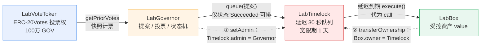

**图解二：提案状态机（8 态）**

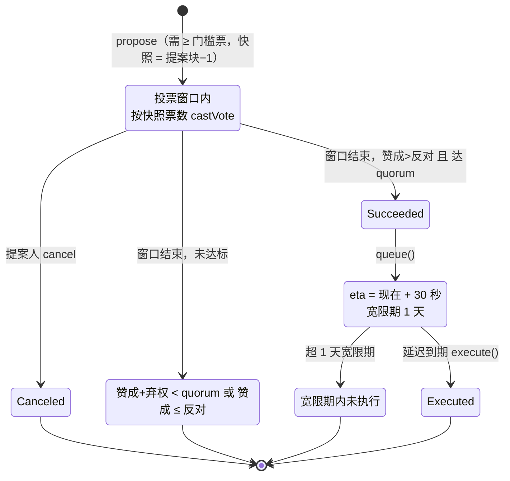

**图解三：部署与提案执行全流程**

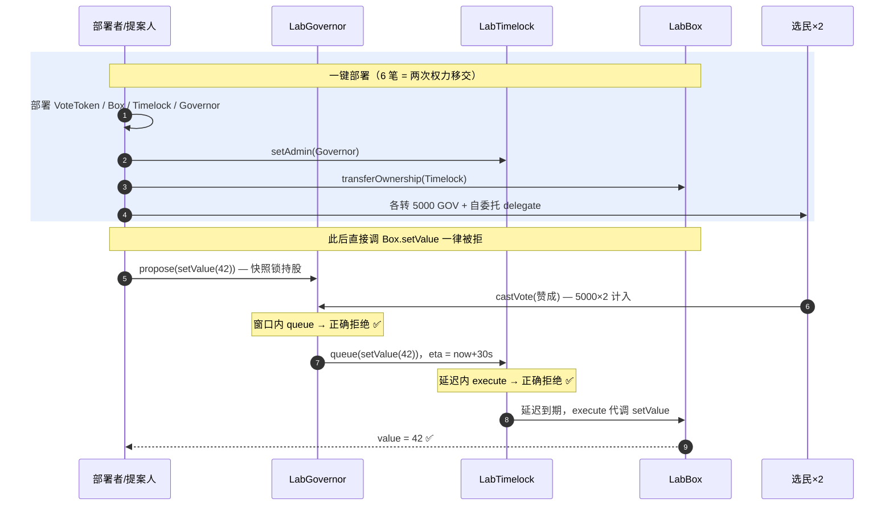

### 10.4 一键部署治理体系

参数默认即可（总量 100 万 GOV、投票窗口 600 秒、quorum 1000、Timelock 延迟 30 秒），
点「🏗️ 一键部署治理体系」= **6 笔交易 + 1 次 17 秒出块等待，约 2 分钟**（时序见 10.3）。

部署后：**任何人想改 Box 的值，必须走「提案→投票→排队→延迟→执行」**。

> 原理提示：铸币时票已记在部署者头上（未委托时票在自己），无需手动委托；
> 提案快照锁定提案区块的持股历史，提案后才买入的代币不计票（见 10.2 机制二）。

### 10.5 投票流程（逐步）

1. 「🧑‍🤝‍🧑 一键准备 2 个选民」：转 gas + 各 5000 GOV + 各自自委托（3×3 笔）。**持币 ≠ 有票，必须 delegate**（见 10.2 机制一）。
2. 「📜 提交提案」：目标默认 Box，新值默认 42（需 ≥1 票门槛）。
3. 👍/👎 投票：当前账户或「两个选民投赞成」（快照计票：选民须在提案**之前**完成委托）。
4. 投票窗口结束（默认 600 秒）且赞成 > 反对且达 quorum → 状态变 Succeeded。
5. 「⏳ 排入 Timelock」（queue）。
6. 等 30 秒延迟到期 →「▶️ 执行」（execute）→ Box 的值真的变了。

实测全链路：提案 → 2 选民各 5000 赞成 → 窗口内 queue 被正确拒绝 → 窗口后 queue → 延迟内 execute 被正确拒绝 → 延迟到期 execute 成功，Box.value = 42。✅

> 投票窗口默认 600 秒是刻意的：浏览器每笔确认约 15~30 秒，窗口太短课堂操作会来不及。想快速看结果可把「投票窗口」改小到 60~90 秒，但只来得及当前账户一人投票。

***

## 十一、🎰 博彩（blockhash 延迟开奖）

### 11.1 应用场景：链上没有"真随机"

随机数是链上应用的老大难：赌场骰子、抽奖、NFT 盲盒、游戏对战都需要它，但 **EVM 里没有真随机**——`block.timestamp`、`coinbase`、`difficulty` 都能被出块者操纵；而 `blockhash(block.number)` 在**当前块**永远是 0（EVM 只保留最近 256 个区块哈希，本区块的哈希要等下一块才能算出）。本站 [LabCasino](file:///Users/i/Desktop/DigitalLabs-web3/besu-local/dex-labs/contracts/LabCasino.sol) 用「**承诺未来区块哈希做种子**」来解决——这是 commit-reveal 模式的教学简化版。真实方案对照：

| 真实方案 | 机制 | 局限 |
| --- | --- | --- |
| Etheroll（2017，链上骰子鼻祖） | 和本站同款：下注锁定未来区块哈希 | 出块者可轻微操纵（挑时机出块/下注） |
| Chainlink VRF | 预言机返回可验证随机数 + 密码学证明 | 真实产品标配，需付费请求 |
| commit-reveal 双方掺熵 | 玩家与庄家各自提交秘密再合并 | 需两阶段交互、防违约 |
| randao / 信标链随机数 | 共识层随机信标 | 依赖协议生态 |

教学简化点：① 庄家=部署者（真实赌场有准备金与监管模型）；② 种子只来自单一区块哈希（掺熵才更稳）；③ 无 KYC/限额。

### 11.2 工作原理：三种玩法的概率、赔率与庄家优势

**开奖时间线**（SEED_DELAY = 3 块 ≈ 45 秒）：

```
下注块 N              N+1      N+2      N+3(seedBlock)    N+4 起可 reveal
  │ bet() 承诺         ─── 出块，哈希逐步生成 ───┤ blockhash(seedBlock) 可读
  │ seedBlock = N+3                                   │ reveal: seed = hash % 100
```

下注时谁也不知道 seedBlock 的哈希（连出块者也不行）；开奖时它已成历史、可验证、不可篡改——**"未来的不确定性"换来了公平**。

**三种玩法**（result = hash % 100，均匀分布 0~99）：

| 玩法 | 判定 | 中奖概率 | 赔率（含本金） | 期望回报 EV | 庄家优势 |
| --- | --- | --- | --- | --- | --- |
| 开小 solo | result < 50（0~49 共 50 个数） | 50% | 1.98× | 0.5×1.98 = 0.99 | **1%** |
| 开大 pair | result ≥ 50（50~99 共 50 个数） | 50% | 1.96× | 0.5×1.96 = 0.98 | **2%** |
| 押中数字 exact | result == 猜的数（1/100） | 1% | 90× | 0.01×90 = 0.90 | **10%** |

（EV = 概率 × 赔率，庄家优势 = 1 − EV。下注 0.05 ETH 开小：中奖拿回 0.099 ETH，期望值 0.0495 ETH，每局平均亏 0.0005 ETH。）

注意两点：① **赔率含本金**——押 1 中 1.98，实际净赢 0.98；② 精确数字赔率最高（90×）但庄家优势反而最大（10% vs 1%）——高赔率玩法给玩家的是心理刺激，给庄家的是更厚的利润，这是整个博彩业定价的通用套路。

**两个失败场景**（都发生在 reveal）：

| 场景 | 原因 | 后果 |
| --- | --- | --- |
| "house broke" | 赌池余额 < 应付彩金 | 开奖失败，先给庄家注资再 reveal |
| "hash unavailable" | 超过 256 块（约 64 分钟）才开奖，旧哈希已滚出 EVM 窗口 | 注单作废——**在窗口内（第 4~256 块）任何人可先 reveal 一次把种子兑现上链（不派彩）**，之后该注单即凭链上种子正常开奖，不再永久卡死 |

### 11.3 业务流程：庄家与玩家

**庄家（部署者）：**

```
① constructor{注资} 部署即开池        ── 或部署后直接转账走 receive() 续注
② （可选）setPaused / withdraw       ── 暂停接受新注 / 提走当前空闲资金
```

**玩家：**

```
① bet(choice, exactGuess){value}     ── ≥0.01 ETH，锁注单号与 seedBlock
② 等待 seedBlock 之后（≥3 块 ≈ 45 秒）
③ reveal(id)                         ── 首次 reveal 兑现种子（种子 0→链上哈希），再算 hash%100 判定，中奖自动打款
```

**对账实验**：下注后立刻点「开奖」会被拒（seed not ready）——验证"延迟承诺"在岗；用「查询注单」看 `canReveal` 从 false 变 true 再开奖；「赌场余额/总下注/总派彩」三数对账（余额 = 注资 + 未开奖注单 + 输掉的注 − 派彩）。

**图解一：开奖时间线（commit-reveal 简化版核心）**

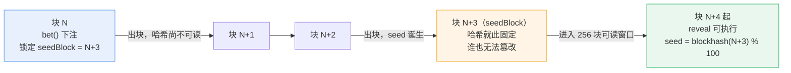

**图解二：庄家与玩家全流程**

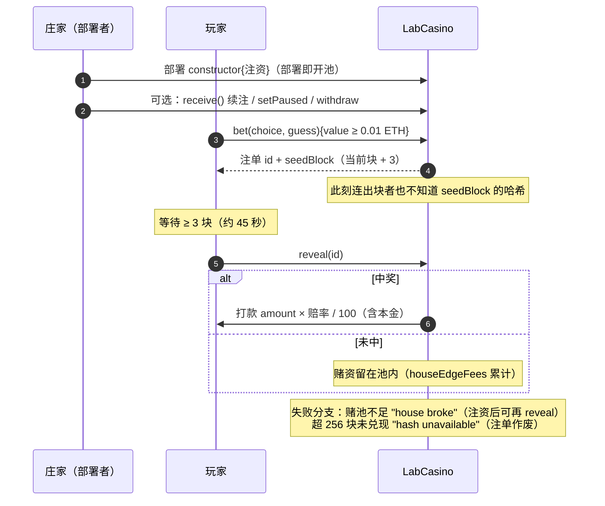

**图解三：reveal 决策逻辑**

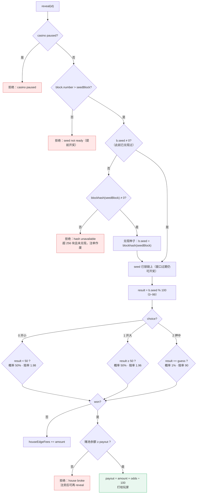

### 11.4 部署赌场

填庄家初始赌池（**ETH，注意账户余额要够**，默认 1.2；余额不足时先改小到 0.4）→
「🏗️ 部署赌场」= **一笔交易完成部署 + 注资开池**（`constructor{value}` 原子绑定，
不存在"部署成功但注资丢交易"产生 0 赌池赌场的中间态；对应 11.3 庄家侧）。

赔率：开小 **1.98×** / 开大 **1.96×** / 押中数字 **90×**（概率与庄家优势见 11.2 表）。

**庄家续注**：赌场余额不足付彩金时（见 11.2 "house broke"），在部署卡片填
「庄家续注金额」→ 点「💰 庄家向赌池续注」——本质是向赌场地址纯转账，
合约 `receive()` 自动进赌池并发 `Deposited` 事件；续够后回「开奖」即可结算。

### 11.5 下注与开奖

1. 选玩法（开小/开大/押中数字 0-99），填下注金额（**最低 0.01 ETH**）。
2. 点「🎲 下注」→ 日志显示注单 ID。
3. **等 3 个区块（约 45 秒）**，点「🔓 开奖」。中奖彩金直接打入账户。
4. 「查询注单 ID」+「赌场余额 / 总下注」只读回显（九元组含 canReveal 标志，见 11.3 对账实验）。

**开奖前的三道前端预检**（都会拦截并给出可操作提示，不浪费 gas）：

| 预检 | 提示 | 处置 |
| --- | --- | --- |
| seed 未就绪 | "seed 区块 N 还没成为历史" | 等出块（每 15 秒一个） |
| 预判中奖且赌池不足 | "本注单会中奖（彩金 X ETH），但赌池只有 Y ETH" | 庄家「💰 续注」≥ X−Y 后再开奖 |
| seed 哈希读不到（超 256 块） | "无法预判，请直接尝试开奖" | 若种子已在窗口内兑现过，reveal 仍可成功 |

实测：部署即开池 1.2 → 下注 0.1 → 3 块后 reveal 成功开奖；house broke 场景续注后 reveal 成功，彩金准确到账。✅

> 教学提醒：blockhash 仍可被重仓庄家轻微操纵（可挑选有利的哈希时机下注），真实产品必须用 Chainlink VRF（见 11.1 对照表）。

***

## 十二、🛡️ 身份权限（AccessControl 角色体系）

### 12.1 应用场景：从"一个 owner"到"角色分工"

前面章节的合约几乎都是 owner 独裁（赌场的 `paused` 只有 owner 能切、借贷的价格只有 admin 能改）。真实的协议面对的是**团队协作**：铸币的归财务、改参数的归风控、发角色的归董事会——把"权力"从个人身上剥离成**岗位**，权限边界写进合约而不是靠人的自觉，这就是 RBAC（基于角色的访问控制）。真实世界对照：

| 真实系统 | 角色实践 |
| --- | --- |
| OpenZeppelin AccessControl | 行业标准（本站 [LabAccessControl](file:///Users/i/Desktop/DigitalLabs-web3/besu-local/dex-labs/contracts/LabAccess.sol) 的原型），数千协议引用 |
| USDC | masterMinter 给各金融机构分别授权铸币额度 |
| Aave V3 | ACLManager 分发 RISK_ADMIN / FLASH_BORROWER 等十几种角色 |
| Safe 多签 | 把 DEFAULT_ADMIN 交给多签——关键角色需要多人共管 |

本站 [LabVipToken](file:///Users/i/Desktop/DigitalLabs-web3/besu-local/dex-labs/contracts/LabAccess.sol#L68-L133) 演示三角色分工：**DEFAULT_ADMIN**（发/收角色）、**MINTER**（铸币）、**PAUSER**（暂停）。教学简化点：① 角色是扁平的 bytes32（真实 OZ 支持角色管理员层级，"谁能管这个角色"本身也是角色）；② 成员数手动计数（OZ 用 EnumerableSet）；③ `topup` 的 gas 金库为课堂演示简化设计。

### 12.2 工作原理：bytes32 角色、职责分离与 renounce 防钓鱼

**角色即哈希**：每个角色是一个 `bytes32` 常量——`keccak256("MINTER_ROLE")`。用哈希不用字符串的原因：comparison 是一次 32 字节等值比对（省 gas），且无需存储可读名（事件里可查）。成员表是 `mapping(role => mapping(account => bool))`，一切操作只有三个动作：

```
grantRole(role, account)   ── 仅 DEFAULT_ADMIN 可调：发角色（幂等，重复发不计数）
revokeRole(role, account)  ── 仅 DEFAULT_ADMIN 可调：回收角色
renounceRole(role, self)   ── 只能放弃【自己的】角色，ADMIN 都不能替你弃
```

**职责分离**（[mint](file:///Users/i/Desktop/DigitalLabs-web3/besu-local/dex-labs/contracts/LabAccess.sol#L92-L99) / [setPaused](file:///Users/i/Desktop/DigitalLabs-web3/besu-local/dex-labs/contracts/LabAccess.sol#L122-L127)）：ADMIN 手握发角色之权却**不能 mint、不能 pause**——想铸币必须先授权一个 MINTER。攻击面被拆小：即使 ADMIN 私钥泄露，攻击者还要再多走一步"发角色给自己"，而这一步会留下 `RoleGranted` 事件，监控可告警。

**renounce 为什么只能对自己执行**（[renounceRole](file:///Users/i/Desktop/DigitalLabs-web3/besu-local/dex-labs/contracts/LabAccess.sol#L53-L60)）：这是 OZ 的防钓鱼关键设计——如果 ADMIN 可以替别人 renounce，那"回收"与"放弃"两种通道混在一起，恶意/ buggy 调用就能悄悄剥掉别人的权限；限定 `account == msg.sender` 后，**丢权限只有两条显式路径**：ADMIN 明示 revoke（有事件、可归责），或你自己主动 renounce。

**gas 金库 topup**（教学彩蛋）：合约 receive() 收 ETH，ADMIN 用 `topup(员工, 0.03)` 给正在操作的员工发 gas——演示"权限与资金随岗位转移"。注释里记录了上一版的设计死结：转给自己时 `msg.sender` 永远是 ADMIN，新员工永远没钱。

### 12.3 业务流程（含 Mermaid 图解）

**权力架构：**

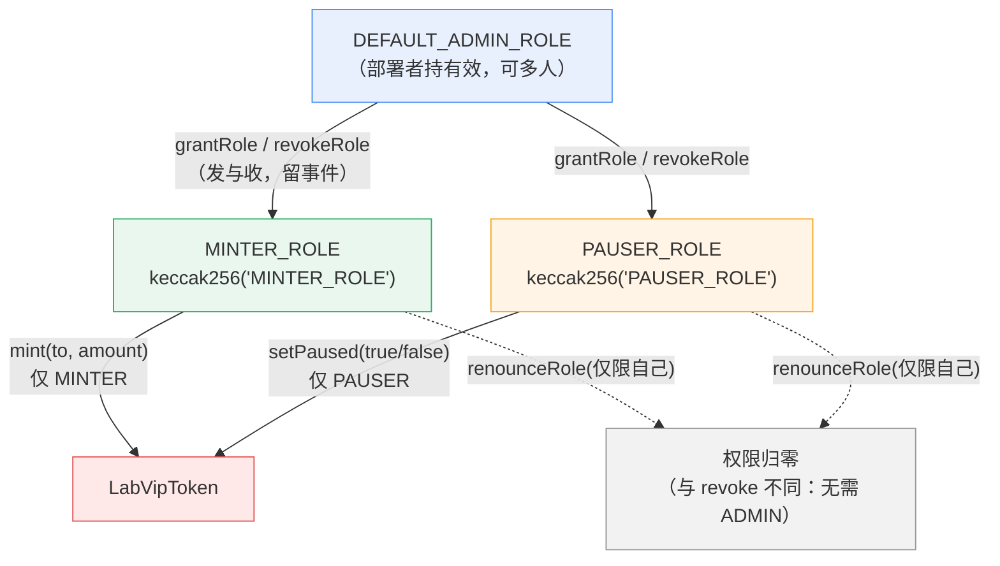

**mint 权限判定：**

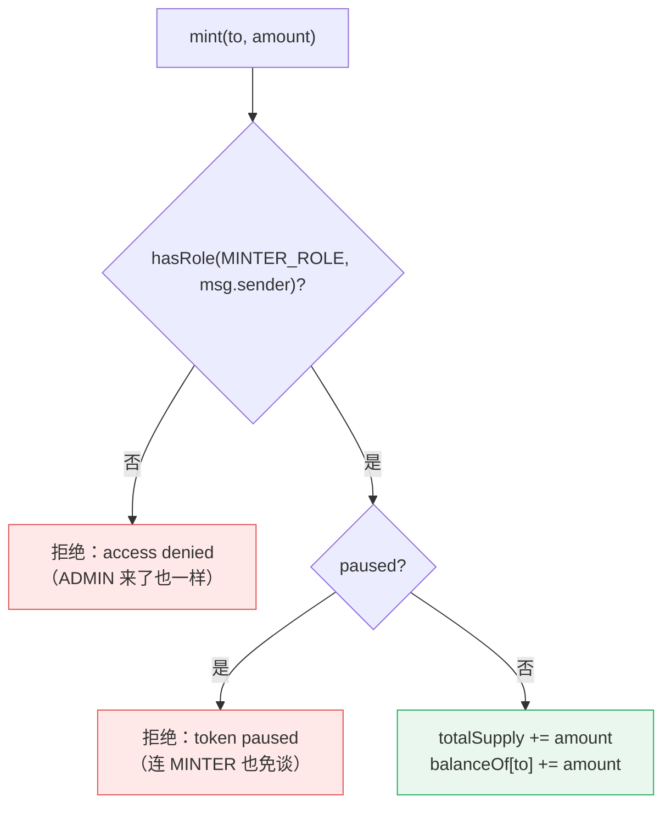

**演示全流程时序：**

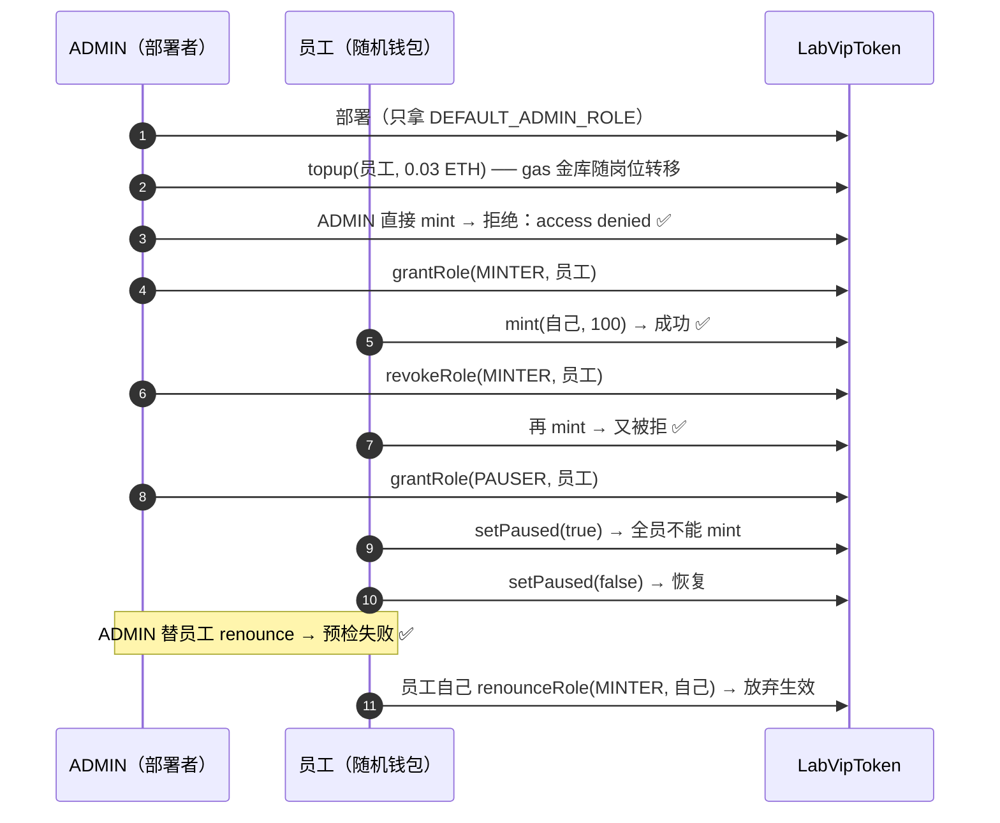

### 12.4 演示流程（按顺序点）

1. 「🏗️ 部署 VIP 代币」：部署者只拿 **DEFAULT\_ADMIN\_ROLE**（不是万能 owner）。
2. 「🧑‍💼 造员工」：生成随机钱包，经合约 topup() 注资 0.03 ETH gas（2 笔，对应 12.3 时序①②）。
3. 「💰 ADMIN 亲自 mint」→ **预期被拒**（ADMIN 只管角色，铸币要找 MINTER——职责分离，见 12.2）。
4. 「⬆️ 提拔员工为 MINTER」→「💰 员工 mint」→ 成功。
5. 「⬇️ 回收员工 MINTER」→ 再点员工 mint → 又被拒。
6. 「⬆️ 提拔员工为 PAUSER」→「⏸️ 员工暂停」→ 此刻连 MINTER 也铸不了（mint 判定链见 12.3 第二张图）→「▶️ 员工恢复」。
7. 「🚪 员工自弃 MINTER（renounce）」：演示 renounce 只能对自己执行（ADMIN 替员工 renounce 预检必失败，见 12.2 防钓鱼）。

角色体系：DEFAULT\_ADMIN（发/收角色）、MINTER（铸币）、PAUSER（暂停），角色标识 = keccak256("XXX\_ROLE")。

实测：授权→mint 成功→回收→mint 被拒→暂停→恢复→renounce 全链路通过，
页面对被拒操作给出精确的 revert 原因预检。✅

***

## 十三、🌉 跨链桥（同链双合约模拟锁仓 + 映射发行）

### 13.1 应用场景：为什么需要桥

一条链是一座孤岛——ETH 在以太坊主网、USDC 在 Polygon、某代币在某 L2。要让资产在岛与岛之间流动，就需要**桥**：在源链锁定（或销毁）资产，在目标链铸造（或释放）等量凭证，让价值跨链流动而无需信任单一中间人。真实世界三种桥模型对照：

| 模型 | 代表 | 安全假设 | 本站对应 |
| --- | --- | --- | --- |
| 锁仓 + 映射发行 | Optimism/Arbitrum 早期 L1↔L2、Multichain | 验证者集合的诚实多数（签名阈值） | ✅ [LabBridgeVault](file:///Users/i/Desktop/DigitalLabs-web3/besu-local/dex-labs/contracts/LabBridge.sol) |
| 流动性池 | Stargate、Across | relayer/做市商垫付，经济激励对齐 | fundPeg 的 B 侧灌流动性 |
| 原生消息层 | LayerZero、CCIP | 中继 + 预言机双因素验证 | — |

教学简化点：① **同链双合约模拟两侧**——真实桥是 A 链和 B 链各部署一份合约，本站用同一合约的 A 侧（deposit/confirmUnlock）和 B 侧（confirmMint/unlock）分饰两角；② 验证者集合固定、无质押/罚没机制（真实 PoS 桥有 slashing）；③ 签名用 EIP-191 personal-sign（教学够用，生产级桥用 BLS 聚合或多签合约）。

### 13.2 工作原理：锁一 peg 一、签名阈值与三层防重放

**核心不变式——桥不创造资产**：源链每锁 1 ETH，目标链才放行 1 beETH；回程每烧 1 beETH，源链才放还 1 ETH。`lockedTotal`（A 侧累计锁仓量）必须时刻等于 B 侧映射币流通量。桥合约自身没有 mint 权——映射币由 FUNDER 角色用 `fundPeg` 预先灌入，演示"映射币总量由源链锁仓量背书"。

**签名阈值安全模型**（[_verifySigs](file:///Users/i/Desktop/DigitalLabs-web3/besu-local/dex-labs/contracts/LabBridge.sol#L254-L270)）：验证者白名单 + quorum（默认 `n/2+1` 多数派）。relayer 收齐 quorum 个验证者对 `(nonce, recipient, amount)` 的 EIP-191 签名后提交 `confirmMint`/`confirmUnlock`。消息哈希：

```
structHash = keccak256(abi.encode(nonce, recipient, amount))
messageHash = keccak256("\x19Ethereum Signed Message:\n32" ‖ structHash)   // EIP-191
signer = ecrecover(messageHash, v, r, s)
```

**三层防重放**（安全设计关键）：

| 层 | 机制 | 防什么 |
| --- | --- | --- |
| ① 单号层 | `_minted[nonce]` / `_unlocked[nonce]` | 同一单号只能放行一次 |
| ② 签名层 | `_usedSigs[keccak256(sig)]` | 同一签名不能跨单号复用 |
| ③ 顺序层 | `signer > last`（地址升序去重） | 防止同一验证者用多个签名凑满 quorum |

`_sigAt` 用内联汇编直接从 calldata 读取 65 字节签名的 r/s/v，绕过 ABI 解码省 gas——这是真实桥合约的常见手法的教学版。

### 13.3 业务流程（含 Mermaid 图解）

**锁铸往返闭环架构：**

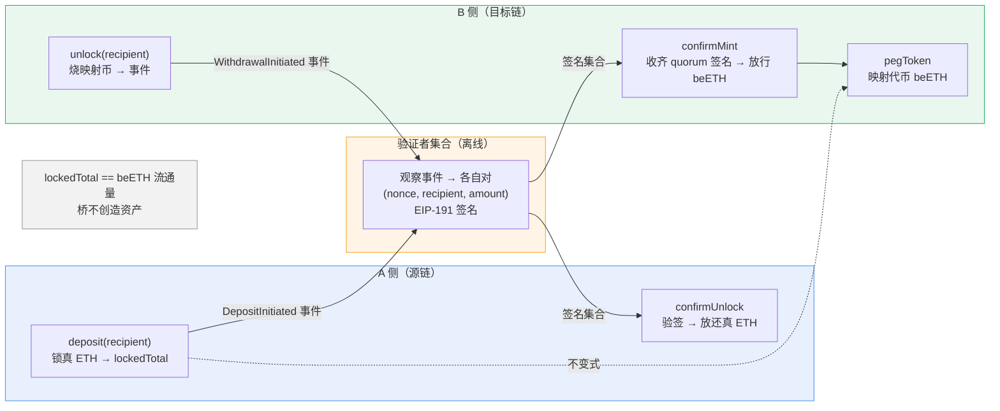

**A → B 跨过去时序：**

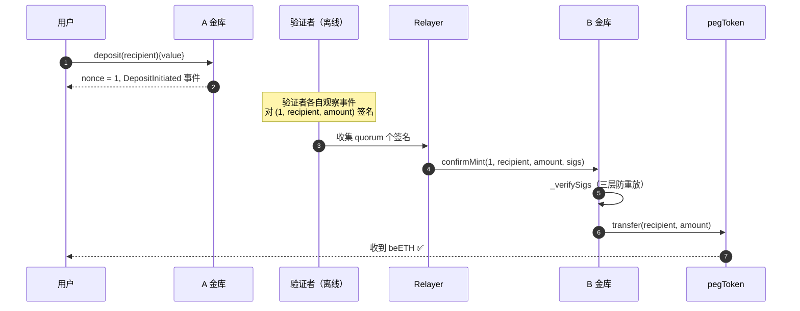

**签名校验流程（confirmMint / confirmUnlock 共用）：**

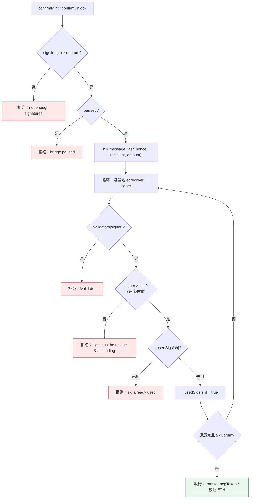

### 13.4 部署桥

**前置**：先到 📡 预言机页点「准备测试数据源」——桥的验证者复用那 3 个私钥。

quorum 默认 2（3 个验证者中 2 人签名即可放行），点「🏗️ 部署桥」：
A 金库 + B 金库 + 映射代币 beETH + 灌 1 beETH 流动性，共 6 笔交易。

### 13.5 跨过去（A → B）

1. 填锁定 ETH 金额（默认 0.05）→「🔒 A 侧锁定（deposit）」→ 显示单号 nonce。
2. 「🪙 验签放行（B 侧 confirmMint）」：浏览器收集 quorum 个验证者对 (单号,收款人,金额) 的 EIP-191 签名，B 侧验签后放行等量 beETH（流程见 13.3 第三张图）。

### 13.6 跨回来（B → A）

1. 「🔥 B 侧烧币（unlock）」：烧掉映射币（先自动 approve），显示回程单号。
2. 「🔓 A 侧验签放真币（confirmUnlock）」：验签后 A 侧放还真 ETH——往返闭环完成。

实测：锁 0.05 → B 放行 → 烧 0.05 → A 放还，A 侧金库余额与个人余额完全对账。✅

> 教学要点：桥不创造资产（lockedTotal == beETH 流通量不变式）；签名按签名者地址升序提交防重放；三层防重放（单号 / 签名 / 顺序）；messageHash = keccak256(abi.encode(nonce, recipient, amount)) 的 EIP-191 personal-sign。

***

## 十四、常见问题（FAQ）与已知注意点

1. **每笔约 15 秒，按钮变灰属正常**。多笔串行操作（部署类）总耗时 45 秒\~2 分钟，看日志进度即可，切勿重复点击。
2. **交易回执 status=0 的常见原因**：余额不足（Besu 提示 Upfront cost exceeds account balance）、代币未 approve、超额抵押校验、非白名单数据源报价、角色缺失、**向不收 ETH 的合约地址纯转账**（21000 gas 打满）。现在所有交易广播前都会先本地模拟执行（`eth_call` 预检），上述问题在点击按钮后立即以可读原因报出，不再广播必失败的交易。
3. **交易被替换 / 节点丢交易**：同一账户连续快速发交易可能被同 nonce 替换丢失；Besu 本地链还偶发"广播后一直不上链"（等待回执超时）。本工具流程严格串行（逐笔等回执），纯转账/授权/借款类交易超时后**自动重签重发**（原笔若后落地会因 nonce 冲突自然作废）；**部署与下注重发不安全**（会产生第二个合约/二次下注），超时时按日志提示稍后核实，切勿重复点击。
4. **dev 账户余额有限**：反复演示博彩（默认庄家注资 1.2 ETH）、借贷 fund 会消耗余额。余额不足时把注资/注入金额改小，或重建链。
5. **换浏览器/清缓存**：页面显示的合约地址、藏品列表、数据源私钥都在 localStorage，清掉后"找不到"旧合约——链上资产仍在，可用「收款查询」按地址找回。
6. **借贷页默认借款 1000**：若改了初始价格，先查「最大可借」再决定借款数，超出会 borrow status=0。
7. **利息每秒 1% 是教学夸张值**：质押/借贷/乐高的利率设计只为课堂内肉眼可见地变化，切勿类比真实协议。
8. **日志字节码大小**：启动日志「模板已加载（字节码 N KB）」为模板合约体积，各模板约 5\~13 KB。
9. **治理窗口**：默认 600 秒是给课堂留的操作时间；快照取提案区块-1 的投票权，先委托后提案。
10. **桥放行报"验证者不足"**：先去预言机页准备 3 个测试数据源（验证者复用其私钥）。
11. **地址必须 0x + 40 位十六进制**（大小写不限，页面会自动转小写），Besu 对非规范地址报误导性错误。
12. **教学环境安全边界**：私钥只存本浏览器、交易本地签名、服务器只转发；但这是本地链，**切勿把真实资产私钥导入本工具**。

***

## 附录 A：localStorage 键位速查

| 键                                          | 内容                  |
| ------------------------------------------ | ------------------- |
| `lab.wallet`                               | 上次使用的账户私钥           |
| `lab.txhist`                               | 最近 20 笔交易记录         |
| `lab.tokens`                               | 我发行的代币列表            |
| `lab.nfts` / `lab.nft.contract`            | 我的藏品 / NFT 合约地址     |
| `lab.staking.<代币>`                         | 该代币的质押池             |
| `lab.amm.<代币>`                             | 该代币的 AMM 池          |
| `lab.lend.<代币>`                            | 该代币的借贷市场            |
| `lab.oracle` / `lab.oracle.reporters`      | 预言机地址 / 数据源登记簿（含私钥） |
| `lab.lego.<代币>` / `lab.lego.borrower.<代币>` | 乐高金库 / 借款人账户        |
| `lab.gov` / `lab.gov.voters.<token>`       | 治理体系四合约 / 选民        |
| `lab.casino`                               | 赌场地址                |
| `lab.access` / `lab.access.worker`         | VIP 代币 / 员工账户       |
| `lab.bridge` / `lab.bridge.orders`         | 桥三件套 / 锁仓单缓存        |

## 附录 B：实测结论摘要

12 个功能模块全部完成端到端实测（RPC 直连 + 浏览器），核心数学（质押应计、AMM 0.3% 手续费、预言机中位数、治理快照/法定票数、桥验签）与链上结果一致。

后续迭代中基于实测报错修复的问题：启动日志字节码大小单位误标（KB）；乐高首注建仓与 fund 丢交易兜底；博彩 0 赌池开业（改为 constructor 原子部署开池 + 庄家续注按钮）、reveal 种子惰性兑现（超 256 块注单不再永久作废）、向不收款合约转账等 status=0 场景（全局 eth_call 广播前预检 + 丢交易自动重发）。
